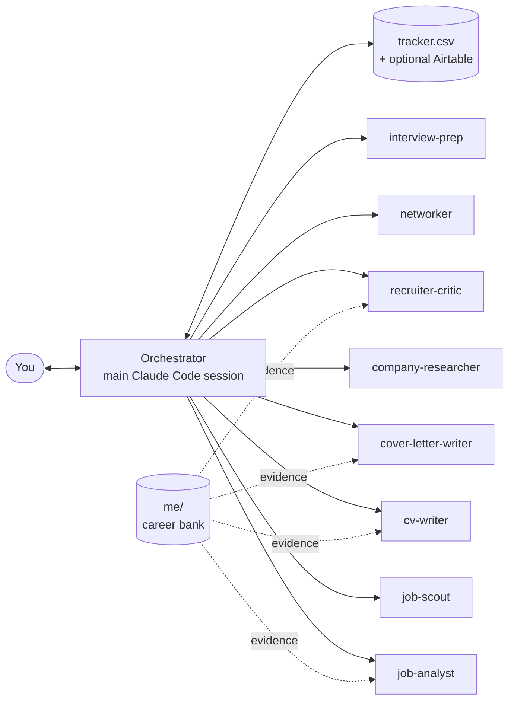

# Career Agents

**A multi-agent job application system built on Claude Code.** It finds postings, scores your fit honestly, tailors a CV and cover letter for each job, gets them reviewed by a sceptical "recruiter" agent, finds people to contact, and prepares you for the interview. You approve every step, and you submit everything yourself.

It was built for, and used in, a real graduate job search in Ireland: 180+ postings tracked, dozens of tailored applications, online tests and interviews. The [lessons from that run](docs/lessons-learned.md) are built into the agents as rules.

```
/add-job https://careers.example.com/graduate-data-analyst
```
→ fit analysis → *your OK* → company research, tailored CV, cover letter, contacts and interview prep (in parallel) → recruiter critique and revision → upload-ready PDFs → tracker updated.

## What makes it different

- **It can't make things up about you.** Every claim must trace to your career bank (`me/`). Writers add an evidence map to each CV, and the critic's first check is a blocking truth audit. Requirements you can't evidence are reported as gaps, with honest ways to bridge them.
- **Requirements first.** The analyst turns each posting into a brief: must-haves, ATS keywords in the employer's own words, the evidence for each, a weighted fit score, and the angle to lead with.
- **Specialised agents that talk through files.** Eight agents, each with one job and a narrow tool list. `analysis.md` is the contract between them, so every step is inspectable and re-runnable.
- **Human checkpoints.** Agents never submit applications, send messages or log into accounts. No LinkedIn scraping.
- **Writes like a person.** Banned clichés, no em-dash chains, matched to your own writing samples.
- **ATS-safe output.** One-column LaTeX with machine-readable text, plus an upload copy with link annotations stripped (some ATS reject those as "active content").
- **Private by default.** Your data lives in git-ignored folders, and a pre-commit hook scans for your name, contact details and IDs before anything is committed.

## See it work

[`examples/demo/`](examples/demo/) holds a complete run for a fictional candidate applying to a fictional employer: the career bank, the posting, the [fit analysis](examples/demo/jobs/Harbourline-Energy/2026-11-02_Graduate-Data-Analyst/analysis.md), the tailored [CV](examples/demo/jobs/Harbourline-Energy/2026-11-02_Graduate-Data-Analyst/cv.pdf) and [cover letter](examples/demo/jobs/Harbourline-Energy/2026-11-02_Graduate-Data-Analyst/cover_letter.pdf), and the [recruiter critique](examples/demo/jobs/Harbourline-Energy/2026-11-02_Graduate-Data-Analyst/critique.md).

## Architecture



| Agent | Job | Output |
|---|---|---|
| `job-scout` | Finds open postings from public ATS feeds, job boards, web search and your inbox; de-duplicates | `job.md`, tracker rows |
| `job-analyst` | Requirements, ATS keywords, evidence map, fit score, gaps, eligibility and application-limit checks | `analysis.md` |
| `company-researcher` | Sourced facts and cover-letter hooks | `company.md` |
| `cv-writer` | Tailored one-column LaTeX CV with an evidence map | `cv.pdf` |
| `cover-letter-writer` | Specific, human-sounding letter | `cover_letter.pdf` |
| `recruiter-critic` | Truth audit, 30-second test, keyword coverage, AI-language check; APPROVE or REVISE | `critique.md` |
| `networker` | Recruiters, hiring managers, alumni; drafts notes for you to send | `outreach.md` |
| `interview-prep` | Real process stages, likely questions mapped to your stories, gap answers | `interview_prep.md` |

More in [docs/architecture.md](docs/architecture.md): the full pipeline diagram and the design decisions.

## Commands

| Command | What it does |
|---|---|
| `/build-career-bank` | Turns your CV and a short interview into the career bank in `me/`. **Do this first.** |
| `/add-job <url \| pasted ad \| folder>` | The full pipeline for one job |
| `/scout-jobs [focus]` | Searches every source, analyses new postings in parallel, shows a digest ranked by fit with urgent deadlines first |
| `/mock-interview <company> [hr \| behavioural \| technical \| case \| final \| tough]` | Live practice interview, scored, with stronger answers built only from your real facts |
| `/job-status` | Today's actions, deadlines, follow-ups, recurring skill gaps and a learning plan |

## Quickstart

**Requirements:** [Claude Code](https://claude.com/claude-code), Python 3 with `pypdf` (`pip install pypdf`), and a LaTeX distribution with `pdflatex` and the XCharter font (TeX Live or MacTeX; on a minimal install run `tlmgr install xcharter fontaxes mweights`).

```bash
git clone https://github.com/<you>/career-agents.git
cd career-agents
engine/scripts/init_workspace.sh       # creates me/, tracker/, inbox/, jobs/ and (in a git repo) the privacy hook
```

1. Put your current CV in `me/cv_original/` (optionally fill in `me/questionnaire.md`).
2. Open Claude Code in the folder and run `/build-career-bank`. It extracts your facts and asks follow-up questions; nothing is written until you confirm.
3. Edit `config/search.md`: role families, cities, scoring. The defaults are an Ireland pack for graduate data, AI and consulting roles; [docs/adapting.md](docs/adapting.md) covers other countries and fields.
4. Run `/add-job <a job URL>` or `/scout-jobs`.

Optional: connect Airtable to mirror the tracker ([config/airtable.md](config/airtable.md)).

## Repository layout

```
.claude/agents/      the eight subagents
.claude/skills/      the five commands
engine/templates/    LaTeX CV and cover letter, job-folder and workspace templates
engine/scripts/      build_pdf.sh, make_upload_pdf.py, tracker_set.py, init_workspace.sh, privacy_check.py
config/              search settings, job sources, target companies, Airtable schema
docs/                architecture, lessons learned, adapting to another country
examples/demo/       a complete fictional run

me/ jobs/ tracker/ inbox/ CHANGELOG.md   your workspace: created by init, git-ignored
```

## Limitations

- Built and tested on Claude Code; the agents are plain Markdown prompts, but the orchestration relies on Claude Code subagents and skills.
- Scouting depends on public endpoints that change. Sites without a public feed (or that block bots) need a manual check.
- Output quality depends on the career bank. A thin `me/` folder gives thin applications, by design.
- The fit score is a structured judgement by a model, not a prediction of your chances.

## License

MIT. See [LICENSE](LICENSE).
