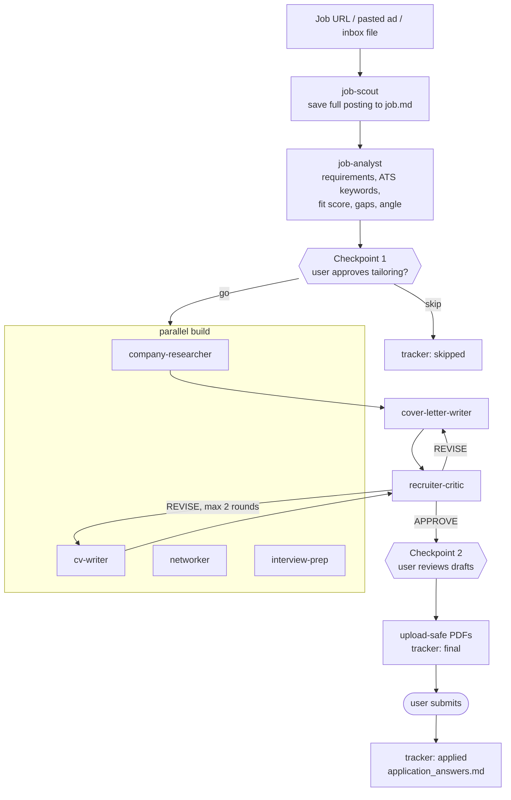

# Architecture

## Two layers

| Layer | What | Shared? |
|---|---|---|
| **Engine** | Agent definitions, skills (commands), LaTeX templates, scripts | Yes, this repo |
| **Workspace** | The career bank (`me/`), job folders, tracker, inbox, changelog | No, git-ignored and local to each user |

The engine never contains facts about a person. Everything personal is read at run time from `me/`, so the same agents serve any candidate.

## Orchestrator and subagents

The main Claude Code conversation is the **orchestrator**. It talks to the user, runs the checkpoints, launches subagents and owns the tracker. Each subagent has one job, a narrow tool list and a fixed output file:

| Agent | Reads | Writes | Tools |
|---|---|---|---|
| `job-scout` | config, inbox, tracker | `job.md`, tracker rows, scout log | web, bash |
| `job-analyst` | `job.md`, `me/`, search.md | `analysis.md` (fit score, evidence map, gaps) | read/write only |
| `company-researcher` | web | `company.md` (shared by all roles at a company) | web |
| `cv-writer` | `analysis.md`, `me/`, template | `cv.tex` → `cv.pdf` | bash (pdflatex) |
| `cover-letter-writer` | `analysis.md`, `company.md`, `me/` | `cover_letter.tex` → `.pdf` | bash (pdflatex) |
| `networker` | `company.md`, `me/profile.md` | `outreach.md` (contacts + drafts) | web |
| `interview-prep` | everything in the folder | `interview_prep.md` | web |
| `recruiter-critic` | the drafts, `me/` | `critique.md` (verdict + fixes) | read-only + bash |

Agents communicate **through files**, not through the conversation. `analysis.md` is the contract: the analyst writes the requirements and the evidence for each, and both writers and the critic work from it. This keeps each agent's context small and makes every step inspectable and re-runnable.

## The `/add-job` pipeline



`/scout-jobs` runs the scout across every source, analyses each new posting in parallel batches, and shows a digest ranked by fit with urgent deadlines first. The user picks which jobs enter the pipeline at the build step.

## Design decisions

**Truth guard.** The biggest risk with an AI CV writer is invention. Every candidate claim must trace to a file in `me/`; writers add an `% EVIDENCE:` block mapping each bullet to its source, and the critic's first check is a blocking truth audit against the career bank. Gaps are reported, not covered up.

**Human checkpoints.** Agents never submit, send or log in. The user approves the fit before effort is spent, approves drafts before anything is final, and does every submission and message themselves.

**Requirements first, evidence second.** The analyst starts from what the employer needs and looks for the strongest true evidence for each need, rather than starting from the CV and hoping it matches.

**Files as memory.** The career bank, the tracker and `CHANGELOG.md` persist across sessions. The orchestrator reads the changelog at the start of each session, so lessons learned once (an ATS that rejects PDFs with links, an employer that only counts the first application) become rules.

**Fallback when subagents can't write.** Some harness setups block subagents from writing report files. A blocked agent returns the file content in a ```` ```file:<path> ```` block and the orchestrator saves it verbatim, so a permission quirk never loses work.

**Single writer for shared state.** Parallel agents return tracker rows instead of editing `tracker.csv`; the orchestrator merges them in one write. Optional Airtable mirroring upserts on a stable ID copied from the CSV.

**ATS-safe output.** One-column LaTeX with real text (`glyphtounicode`) so parsers can read it, and `make_upload_pdf.py` strips link annotations and open actions that some ATS reject as "active content".

**Privacy by construction.** The workspace is git-ignored, and `privacy_check.py` (installed as a pre-commit hook) scans everything git would publish for the user's contact details, real email addresses, phone numbers and IDs.
